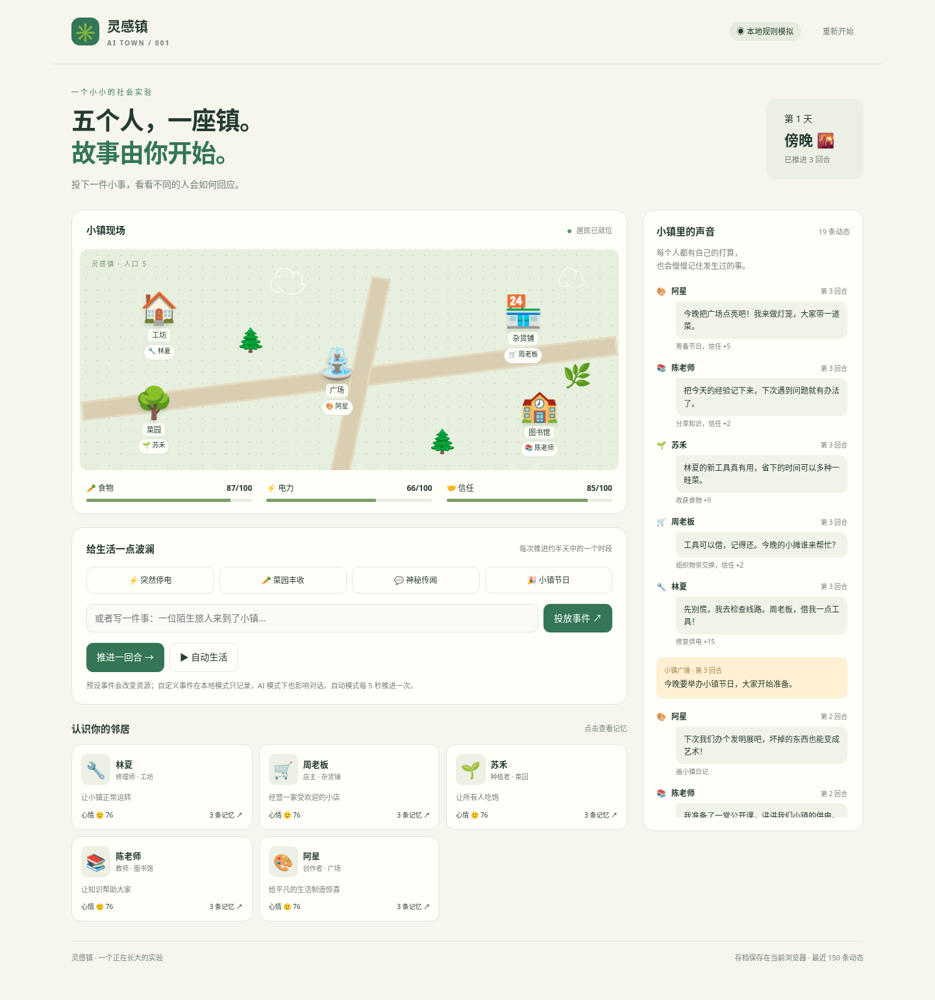

# 灵感镇 · AI Town

五个性格不同的居民，一座会发生小事的小镇。你可以投放事件，观察他们的行动、对话和记忆。

这是第一版实验原型：**本地规则模拟开箱即用，真实 AI 对话按需接入。** 无密钥时不调用模型，也不把模板对话称为模型生成。

## 小镇一瞥



*第一版实际运行截图，本地规则模拟模式。投下一个事件，看看五位邻居如何应对。*

## 运行

需要 Python 3.10 或更新版本，无第三方运行依赖。

```bash
cd projects/ai-town
python3 server.py
```

在自己的电脑运行时，在浏览器访问 `http://127.0.0.1:8000`。默认只监听本机；端口可通过 `--port 8001` 修改。云环境里的浏览器访问需要平台提供端口访问能力，普通电脑浏览器不能直接访问云机器的 localhost。

## 怎么玩

- 点击「推进一回合」，看看居民的日常。一日有清晨、午后、傍晚和夜晚四个回合。
- 投放停电、丰收、传闻或节日事件，改变食物、电力或信任。
- 输入自定义事件，让故事沿着你的想法发展。
- 开启「自动生活」，每次回合完成后等待 5 秒再推进；接入 AI 时会产生持续 API 用量，玩完记得暂停。
- 点击居民卡片，查看性格、行动及最近 8 回合记忆。
- 进度自动保存在当前浏览器，刷新后继续；「重新开始」会清空该存档。

时间线最多保留 150 条动态。不同浏览器、不同地址不共享存档。

## 五位居民

| 居民 | 身份 | 想做的事 |
| --- | --- | --- |
| 林夏 🔧 | 修理师 | 让小镇正常运转 |
| 周老板 🛒 | 店主 | 经营一家受欢迎的小店 |
| 苏禾 🌱 | 种植者 | 让所有人吃饱 |
| 陈老师 📚 | 教师 | 让知识帮助大家 |
| 阿星 🎨 | 创作者 | 给平凡的生活制造惊喜 |

## 接入真实 AI 对话（可选）

服务端支持 OpenAI 兼容的 Chat Completions 接口，需支持 `response_format: {"type":"json_object"}`。在启动服务前配置环境变量：

- `TOWN_API_KEY`：API 密钥，只在服务端读取，不写入前端、存档或仓库。
- `TOWN_API_BASE`：接口根地址，默认 `https://api.openai.com/v1`。使用可信 HTTPS 服务。
- `TOWN_MODEL`：模型名称，默认 `gpt-4o-mini`，可换成供应商支持的模型。

可以通过运行环境的安全设置注入密钥。在本地 Bash 终端也可隐藏输入：

```bash
read -rsp 'API key: ' TOWN_API_KEY
export TOWN_API_KEY
# 可按供应商需要设置 TOWN_API_BASE 和 TOWN_MODEL。
python3 server.py
```

每回合发出一次模型请求，由模型生成五位居民的对话。提示中包含性格、目标、当前资源、行动、个人近期记忆和最近对话。只有点击推进、投放事件或开启自动生活后才请求模型。请求失败或输出不符合格式时，界面会明确提示回退到本地模拟，并暂停自动生活。

**模型当前只决定说什么。** 行动和资源变化仍由 Python 规则引擎决定，居民不是五个独立自主规划的智能体。自定义事件在本地模式仅进入广播和记忆，不会被自动理解为资源规则；AI 模式下也会影响对话。

## 结构与后续扩展

```text
ai-town/
├── server.py          # HTTP 接口、资源规则、记忆和模型适配
├── test_server.py     # 功能与接口测试
├── docs/              # README 界面预览
└── static/
    ├── index.html     # 小镇地图、事件、居民与时间线
    ├── style.css      # 响应式界面，无外部资源依赖
    └── app.js         # 操作、自动推进和浏览器存档
```

适合继续加入：居民自主选择行动、私人关系与对话、可回放的实验种子、事件插件，以及模型策略的对比评测。第一版先让“事件 → 行动 → 对话 → 记忆”闭环能跑通。

## 验证

```bash
python3 -m unittest -v
```

测试覆盖事件效果、长时间运行的资源和记忆边界、HTTP 请求校验、模型接口模拟及失败回退。真实供应商 API 调用需要配置自己的密钥，模拟接口通过不代表真实服务已验证。

这是本地单人原型，存档由客户端提交，尚无用户隔离或认证，不适合直接部署为公网多人服务。

本项目沿用仓库的 [Apache License 2.0](../../LICENSE)。
