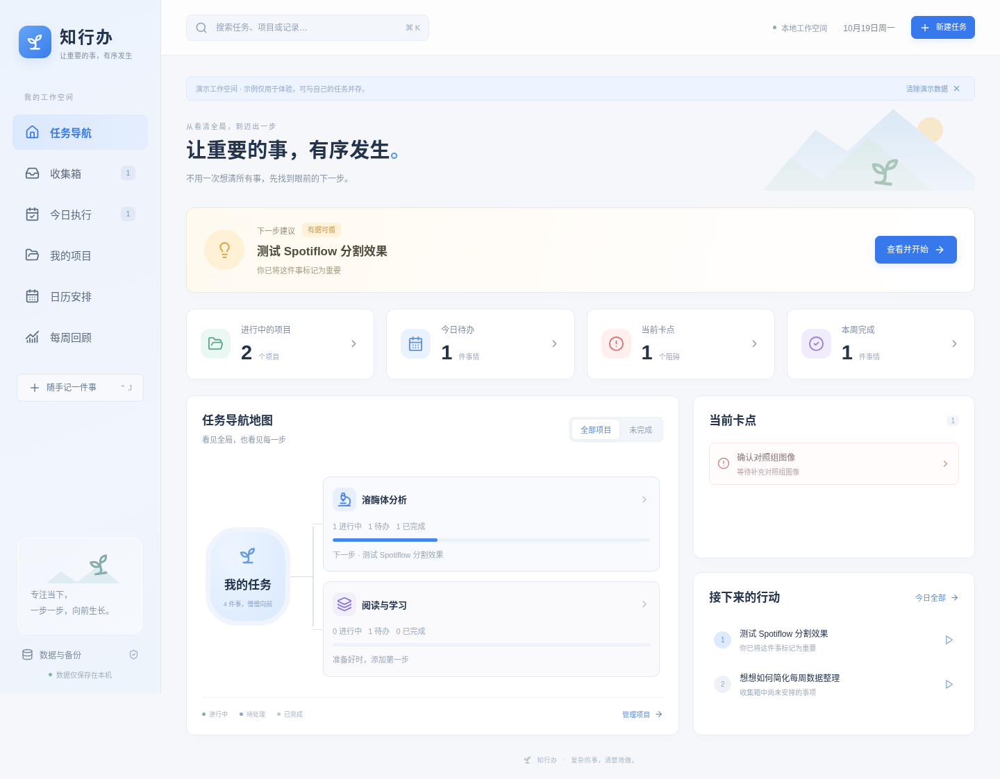

# 知行办

本地个人任务管理工具：先把事情记下来，再看进展、卡点和下一步。适合 Windows 桌面使用；详细过程继续保存在 Obsidian。

## Windows 启动

1. 安装 [Node.js 22 LTS](https://nodejs.org/)（22.12 或更高版本），安装时保留 npm 和加入 PATH 选项。
2. 下载并解压本仓库，进入 `projects/zhixingban/`。
3. 双击 `start.cmd`。首次会联网安装依赖，随后构建应用并打开 **http://127.0.0.1:5173**。
4. 使用期间保留启动窗口；关闭窗口或按 `Ctrl+C` 停止服务。下次仍双击同一脚本。Agent 自动启动的后台服务可用 `stop.cmd` 停止；升级前也可先双击它。

脚本会检查依赖锁文件，升级依赖时自动重新安装；普通启动不会重复安装。每次仍重新构建，确保加载当前源码。

依赖安装完成后，正常启动和核心功能均可离线使用，无须账户、密钥、云服务或付费 API。首次安装失败时，修复网络后重新运行脚本即可。

**v1.4 起，正常启动使用本地文件存储，界面和 Agent 共享数据。** Windows 数据目录为 `%LOCALAPPDATA%\Zhixingban`，可以在「数据与备份」查看实际路径。换浏览器仍能读取同一服务的数据。

从旧版升级：先导出一份 JSON，关闭旧启动窗口，再使用新版脚本；首次请用原浏览器和个人资料访问 **http://127.0.0.1:5173**。当本地文件尚无数据时，应用自动迁移该地址的旧 IndexedDB 记录；浏览器原记录不删除。如果 Agent 已先创建文件数据，不会自动覆盖，可在「数据与备份」导出旧记录后明确恢复。新格式请使用 v1.4 或更高版本读取。

若只使用静态网页预览，应用保留兼容的浏览器模式并明确标注；此模式没有 Agent 接口，快照也仍在浏览器内。不要把浏览器快照当作电脑文件备份。

如果提示端口 5173 已占用，先使用已打开的知行办窗口，或停止占用端口的程序后重试。脚本不会自动改用其他端口。

界面空闲时约每两秒读取 Agent 或其他窗口的更新。并发修改发生冲突时停止陈旧写入并提示导出、刷新，避免覆盖已经保存的记录。外部更新到来后，该窗口的旧撤销记录会清除。

## 从一件事开始

- **收集**：输入标题并按回车，无需分类或日期。可以稍后批量整理或转换为正式任务。
- **首页**：在稳定布局的任务地图中查看项目、完成进度、阻碍和下一步；点击节点进入项目。
- **今日**：专注今天的任务，开始、暂停、完成，或手动调整顺序。推荐顺序依据重要任务、期限和依赖等已有信息，并展示理由。
- **项目**：维护目标、可选阶段和任务清单，进度自动计算；阶段不是必填项。
- **日历**：切换周／月视图，点击日期添加任务或固定时间日程。计划日期表示准备做的那天，截止日期表示必须完成的期限。
- **回顾**：自动汇总本周完成、未完成、项目进展和卡点，也可以补充一段回顾笔记。

六个页面共享同一份数据，任何主要页面都可以快速添加任务。点击任务打开右侧详情，编辑自动保存；保存异常会在界面提示。可以搜索任务并直接打开详情。

建议先试一次：**新增任务 → 归入项目 → 安排到今天 → 在日历查看 → 标记完成 → 查看首页进度和本周回顾**。

首次打开是空数据，可自行开始记录，也可主动载入明确标记的演示数据。演示数据可单独清除，不必删除自己添加的内容。演示日期根据载入当天生成。

## 外观与顺手操作

点击左下角「外观与体验」，可以选择：

- 浅色、深色或跟随系统；跟随系统会实时响应系统明暗变化。
- 海洋蓝、鸢尾紫、森林绿、玫瑰粉、日落橙、石墨灰六组强调色。
- 较小、标准（默认）、较大、特大四档字体大小，包含任务、按钮、说明与弹窗；可在设置内即时预览。默认正文从旧版约 14px 调到 16px，辅助说明也同步放大。
- 舒适／紧凑显示密度，以及减少动态效果。系统启用减少动态效果时，应用也会遵循。

外观即时生效并在本机自动记住；右上角月亮／太阳按钮也可以快速切换明暗。设置只影响界面，不改变任务记录；JSON 备份继续专注于任务、项目、日程与回顾数据。

`Ctrl+J` 快速记录，输入后回车保存；`Shift+Enter` 或「保存并继续」可连续记录。可用「安排今天」轻点安排，不必填写其他属性。`Ctrl+K` 搜索，方向键选择、回车打开、Esc 收起。弹窗自动聚焦，Tab 在当前弹窗内移动，Esc 关闭最上层并返回原来的位置。任务删除会先在应用内确认。

日常体验新增：

- 右上角撤销或 `Ctrl+Z`（非文字输入时）恢复本窗口最近操作；连续编辑同一字段会合并为一步，最多保留 30 步，刷新后清空。任务和日程删除后进入「数据与备份 → 回收站」，可找回进展和有效关联。
- 项目「继续上次工作」显示最近结果、卡点、可选下一小步和笔记入口。今日页保留下一小步；旧计划可以一键继续、改日或暂不安排，不修改截止日期。
- 任务详情的「重复、耗时与模板」支持按计划周期或完成后重复、暂停重复、可选耗时和存为模板。完成后只生成下一次未来任务，保留本次结果，不补建错过的积压。月末重复保持原日期锚点；截止日期不自动复制。
- 「常用模板」可增改删，在快速添加时选择。模板说明可一行一个步骤，生成后的任务各自编辑。
- 首页最近两周进展条、回顾当前卡点持续时间、日历未来七天安排均可点击追溯事项。空白表示暂无记录，不代表没有工作；完成次数和任务比例不等于科研价值或目标完成程度。耗时未填时明确显示未估时。
- 页面切换保留滚动位置，项目选择、归档筛选、地图筛选、日历视图/日期和回顾周在本机记住。

## 预警与进展

首页「需要调整」会合并显示同一任务或项目的预警，并说明原因和建议行动。点击「查看并调整」进入任务详情或项目，记录结果、调整日期或处理阻碍；提醒在站内展示，离线可用。

左下角「预警原则」支持新增、编辑、停用和删除。每条可修改名称、说明、范围、检查条件、天数、单位和建议行动；默认提供五条规则：项目连续 7 个自然日没有有效进展、Bug 排查经过 1 个工作日无新进展、检查目标到期未确认达成、截止日期风险，以及阻碍持续 3 个工作日或到达约定跟进日。项目和 Bug 可单独覆盖默认停滞原则的阈值；自定义原则按各自阈值检查。文字原则选择“不自动检查”，供你与 Agent 阅读。不会把任意文字或科研推断自动当成可执行规则。

任务/项目里的「进展与预警」可记录一句结果；完成任务和确认目标达成也会自动计入有效进展。阴性结果、排除一种假设同样有价值。改标题、改期和打开页面不重置进展计时。展开「目标检查点与跟进设置」可以填写目标、可选达成条件、检查日期和下次跟进日期；科学目标是否达成由你确认。修改截止日期、检查目标/日期和下次跟进日期会留下调整记录。

快速记录仍然只需标题。Bug 在详情中主动选择「Bug 排查」，开始后才检查停滞。未开始、计划未来和暂停的事项不触发停滞提醒，已完成/归档事项退出检查；明确的日期约定仍会提示。旧数据从升级后开始观察，减少误报。工作日按周一至周五计算，不代表实际投入工时，暂不配置节假日。

回顾自动汇总所选周的有效进展和调整，并单独显示当前仍待处理的预警。规则、进展和调整都随 JSON 备份保存；包含新原则、重复或回收站字段的备份请使用 v1.4 或以后版本恢复。

预警效果（仅含演示数据）：[首页预警](docs/01-home.png) · [记录科研进展](docs/monitoring/04-dark-large-progress.png)。也可在「数据与备份」载入演示，查看预设的目标未达和阻碍跟进提醒。

## 备份与恢复

在侧栏的「数据与备份」中导出 JSON，保存到自己选择的位置。导出包含任务（含已完成）、项目（含归档）、阶段、日程、回顾笔记、原则、进展、重复设置、模板和回收站；外观与视图偏好仍保留在本机浏览器。

导入用于恢复备份，会校验数据结构及关联关系，并在替换当前数据前要求确认；当前数据能正常读取时，确认后会先下载当前数据的安全快照。浏览器若拦截下载，请允许下载并确认备份文件已保存。也可直接导入数据目录中的快照 JSON 或 data.json，仍执行完整内层校验。导入是整体替换，不是合并。可先导出当前数据，再导入另一份备份。

正常启动时，本地服务会在每日首次修改前保留安全快照；替换数据和每次 Agent 修改前另存快照，最多保留 30 份。在「备份快照」中可立即备份、下载和恢复；快照位于数据目录的 backups/。建议偶尔将完整 JSON 另存到其他磁盘。

如果原数据无法读取，应用停止普通写入。使用已知正常 JSON 明确恢复时，本地文件服务会先将无法读取的原文件留在 recovery/；浏览器模式会提示无法生成安全快照。初始化失败不会默默覆盖。

Obsidian 关联只保存笔记路径或 `obsidian://` 链接。有效的 Obsidian 链接由本机 Obsidian 打开；工具不会读取、修改或同步笔记库。

## 本地 Agent

支持 Codex 等 Agent 的 MCP stdio 与 JSON CLI。界面里的「数据与备份 → Agent 接入」有配置示例，详细操作与约束见 [AGENT_API.md](AGENT_API.md)。不需要在应用里填写模型 API Key。

```bash
node service-dist/cli.mjs schema
node service-dist/cli.mjs query --file query.json
node service-dist/cli.mjs apply --file command.json
```

可以读写任务、项目、日程、进展、原则、模板和回收站。浏览器关闭时仍可工作；Agent 会自动连接或启动同一个本地服务。首次升级务必先打开原浏览器完成迁移。

## 界面预览

以下为 v1.3 演示界面，供了解原有六页结构；v1.4 新增图表与操作以实际运行界面为准。日期与统计由运行时数据生成。

[](docs/01-home.png)

[首页](docs/01-home.png) · [收集](docs/02-inbox.png) · [今日](docs/03-today.png) · [项目](docs/04-projects.png) · [日历](docs/05-calendar.png) · [回顾](docs/06-review.png)

[字号设置预览](docs/appearance/08-font-settings.png) · [深色外观设置](docs/appearance/00-dark-settings.png) · [深色首页](docs/appearance/01-dark-home.png) · [鸢尾紫浅色首页](docs/appearance/07-light-purple-home.png)

## 开发与检查

技术栈为 React、TypeScript、Vite、Lucide Icons 和轻量 Node 本地服务，兼容旧 IndexedDB；没有云资源或外部网络依赖。

```bash
cd projects/zhixingban
npm ci --no-audit
npm run dev
```

生产构建及本地预览：

```bash
npm run build
npm run preview
```

macOS／Linux 可运行 `bash start.sh`，或使用上面的 npm 命令。开发与预览均固定在 `http://127.0.0.1:5173`，不要同时运行。

验证命令：

```bash
npm test
npm run build
npx playwright install chromium
npm run test:e2e
```

Playwright 首次安装浏览器需要网络；Linux 按安装提示补齐浏览器系统依赖。实际完成的验证、已知问题与后续工作见 [STATUS.md](STATUS.md)，架构和维护约定见 [AGENTS.md](AGENTS.md)。

当前为本地浏览器界面与 Node 服务，不是 Windows 安装包；没有跨设备同步和系统级通知。开发模式也启动本地服务，请勿与正式启动共用目录同时运行。自动化测试使用独立临时目录，旧浏览器回归使用 ZHIXINGBAN_BROWSER_ONLY=1；不要以测试模式记录真实事项。
